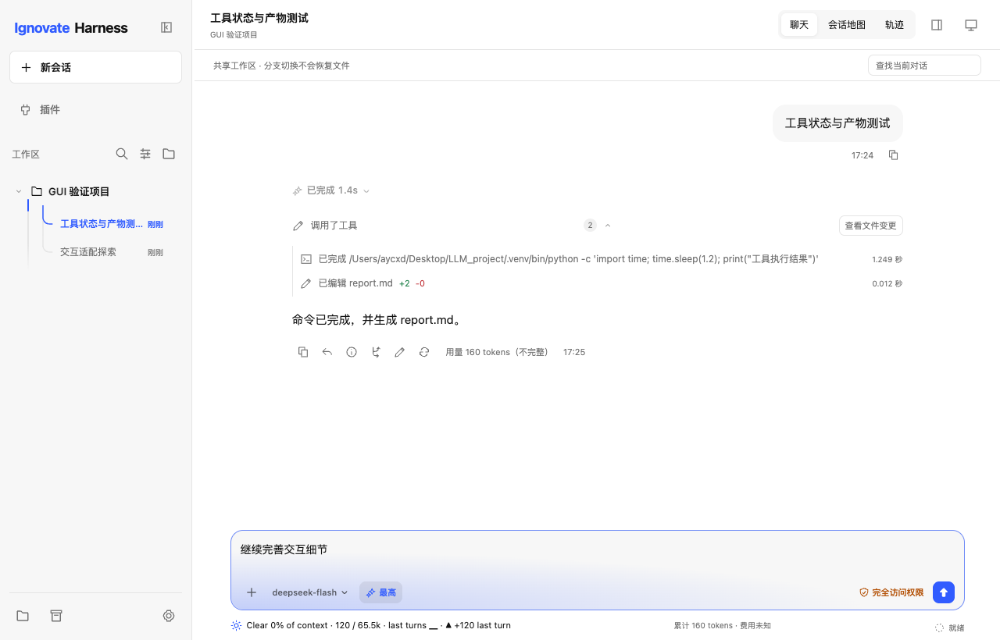

<h1 align="center">Ignovate Harness</h1>

<p align="center">本地运行的桌面与终端编码助手，让模型在可控权限下理解、修改和验证你的项目。</p>

<p align="center">
  <a href="https://github.com/aycxd0528/ignovate_harness/releases"></a>
  <a href="https://github.com/aycxd0528/ignovate_harness/actions/workflows/tests.yml"></a>
  
  <a href="LICENSE"></a>
</p>

<p align="center">
  <a href="docs/INSTALL.md">下载安装</a> ·
  <a href="docs/GUI.md">GUI 指南</a> ·
  <a href="docs/PROJECT.md">项目介绍</a> ·
  <a href="docs/CLI_REFERENCE.md">CLI 参考</a> ·
  <a href="docs/RELEASE_NOTES.md">更新记录</a>
</p>



## 快速开始

从 [GitHub Releases](https://github.com/aycxd0528/ignovate_harness/releases/latest) 下载适合你系统的安装包。安装器会准备运行环境；首次运行时按提示配置模型提供商、API 地址、模型 ID 和 API Key。

| 平台 | 安装包 | 说明 |
| --- | --- | --- |
| macOS 13+（Apple Silicon） | [桌面版 DMG](https://github.com/aycxd0528/ignovate_harness/releases/download/v1.2.1/Ignovate-1.2.1-macos-arm64.dmg) | 拖入 Applications 后打开 |
| macOS / Linux | [CLI 安装包](https://github.com/aycxd0528/ignovate_harness/releases/download/v1.2.1/ignovate-1.2.1-unix.tar.gz) | 解压后运行 `install.sh` |
| Windows 11 x64 | [CLI 安装包](https://github.com/aycxd0528/ignovate_harness/releases/download/v1.2.1/ignovate-1.2.1-windows.zip) | PowerShell 原生安装，无需 WSL |

CLI 安装完成后，在要处理的项目目录运行：

```sh
ignovate set up
ignovate
```

安装位置、升级、校验和源码安装步骤见[安装说明](docs/INSTALL.md)。

## 能做什么

| 能力 | 说明 |
| --- | --- |
| 聊天与会话地图 | 在聊天中处理任务，或在画布上继续追问、创建分支 |
| 受控的文件与命令操作 | 按权限模式执行工具调用，必要时先展示操作并等待批准 |
| 任务与验证 | 保存目标、步骤和验收条件，记录实际运行的验证命令与结果 |
| 上下文与记忆 | 管理长会话上下文，并按需读取用户、项目和本地记忆 |
| 多种工作方式 | 提供桌面 GUI、Textual/inline 终端界面及 JSON 无头模式 |

桌面端支持 macOS Apple Silicon；CLI 支持 macOS、Linux 和 Windows 11 x64。项目沿用 DeepSeek 模型连接，也支持配置兼容的提供商。更多设计与边界见[项目介绍](docs/PROJECT.md)。

## 文档

| 文档 | 内容 |
| --- | --- |
| [安装说明](docs/INSTALL.md) | 下载、安装、升级、校验和源码构建 |
| [GUI 使用指南](docs/GUI.md) | 桌面与浏览器界面、会话地图和工作区 |
| [CLI 与运行时参考](docs/CLI_REFERENCE.md) | 命令、配置、权限、任务、记忆、MCP 与 Skills |
| [项目介绍](docs/PROJECT.md) | 项目定位、架构、工作流与安全边界 |
| [更新记录](docs/RELEASE_NOTES.md) | 版本变更 |
| [React Bits 接入说明](docs/REACT_BITS.md) | 桌面界面的动画与交互组件 |

## 开发

需要 Python 3.11 或更新版本。在项目根目录创建虚拟环境、安装依赖并运行离线测试：

```sh
python3.11 -m venv .venv
source .venv/bin/activate
python -m pip install -r requirements.txt
python -m pip install -e .
python -m unittest discover -s tests -v
```

完整贡献、CI 和发布流程见 [CLI 与运行时参考](docs/CLI_REFERENCE.md) 与 [CI 工作流](.github/workflows/tests.yml)。

## 许可证

[MIT](LICENSE)
