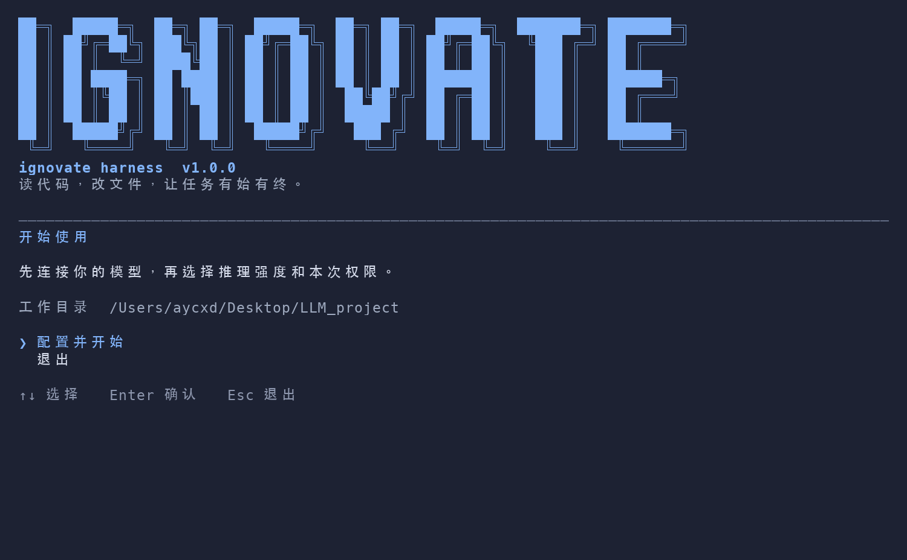
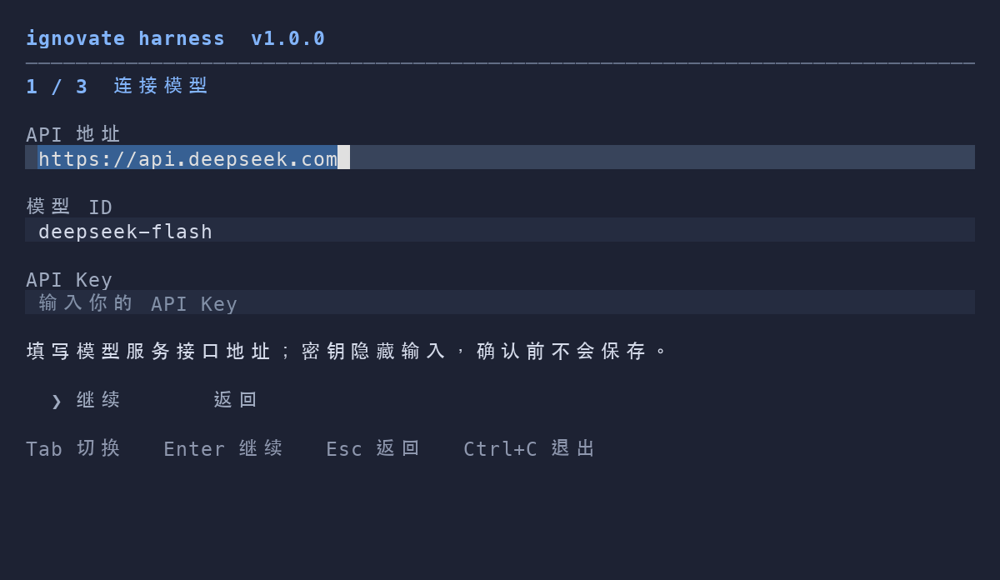
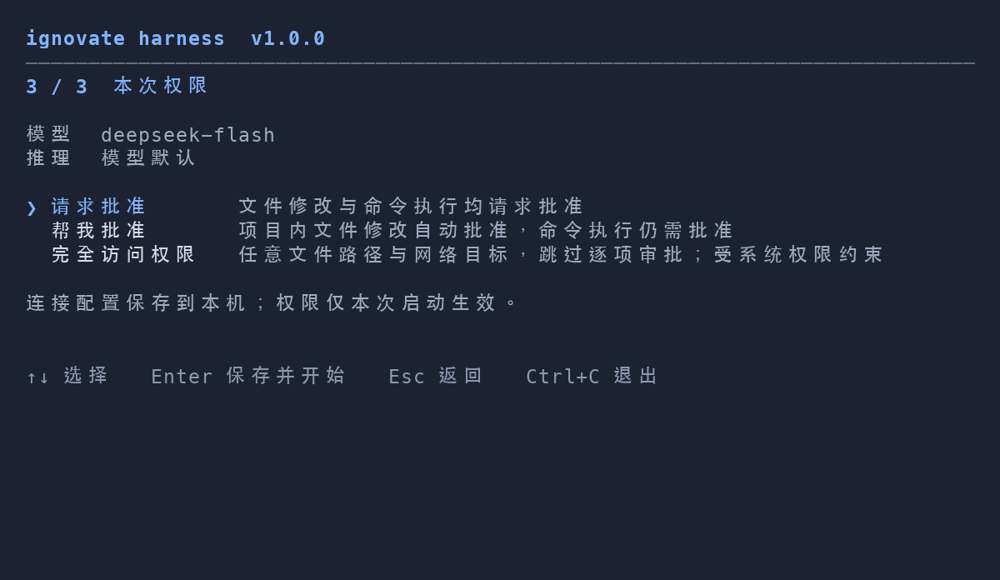

# ignovate harness 欢迎与配置界面改版

日期：2026-10-07。

## 设计与交付

参考用户提供的天枢终端和 Claude Code 设置截图，将现有欢迎及配置流程重新排版。

- 欢迎页左对齐，顶部蓝色 `IGNOVATE` 字标、产品名与版本，下方用一条细线划分操作区。
- 深蓝背景 `#1d2233`、品牌蓝 `#82b4fa`、正文 `#d5dbea`、次要信息 `#a0abc0`、分隔线 `#626d85`；沿用终端字体。重点放在字标，正文和操作区保持简洁。
- 移除大块默认按钮及下拉框。欢迎页和推理/权限页采用带 `❯` 光标的键盘选项。
- 配置分为“连接模型 → 推理强度 → 本次权限”三步，顶部显示进度。
- Enter 推进；输入页 Tab 切换，Enter 也可依次前往下一字段；选择页用方向键；Esc 返回，Ctrl+C 退出。最终权限页确认才保存。
- 表单输入在步骤间保留，已有密钥留空保留；密钥不显示在摘要或预览中。
- 命令行指定的推理/权限仍被锁定，并在界面中说明。
- 小窗口隐藏大字标，保留产品标题；配置正文可滚动。

本轮修改集中在 Textual 欢迎和模型配置，已有会话主界面的布局沿用当前实现。

## 自审发现及修复

首轮全量回归有 6 个失败、1 个错误：

1. 首次配置保存后，旧配置测试读取真实用户连接配置，覆盖测试环境的输入。已为相关测试指定临时配置路径；未改写用户连接配置的优先级。
2. `doctor` 在禁用 site-packages 且已有用户配置时，会通过连接校验导入 `dotenv`，导致无法输出 JSON。将纯连接校验及错误类型放入标准库模块 `nailong/core/connection.py`，`config.py` 保留原导入接口，BootstrapStore 直接使用纯校验模块。
3. 隔离测试同时暴露 macOS `/var` 与 `/private/var` 的路径别名问题。显式配置文件继续使用 BootstrapStore 的规范化父目录，文件名仍经过边界及符号链接检查。

首轮失败断言曾回显本机 API Key。本地失败日志已脱敏，之后的测试使用临时配置；聊天工具历史无法回改，建议更换该 Key。报告及预览不包含密钥值。

## 验证

- 专项回归：27 项，3.262s，OK。
- 最终全量：**999 项，92.864s，OK**。命令：`.venv/bin/python -m unittest discover -s tests -q`。
- 新增/调整行为用例覆盖取消不写入、返回操作、最后一步保存、键盘选择、CLI 锁定、未知模型重置、密钥留空及小窗口输入和操作提示可见。
- 12 个实际布局检查通过：213×56、100×32、80×24，各含欢迎页及三个配置步骤；操作提示均在视口中，预览流程没有保存配置，没有密钥出现在显示文本中。
- 从真实用户配置执行 `python -S main.py doctor --output-format json`：输出合法 JSON，认证配置检查通过；未检查网络，依赖缺失使诊断退出码为 1，符合诊断行为。
- 本轮不执行模型 API 请求。

[最终测试日志](2026-10-07-onboarding-unittest.log) · [布局检查](2026-10-07-onboarding-layout.json)

## 预览

PNG 基于实际 Textual compositor 的字符、位置和颜色，正文以 macOS 等宽及中文字体绘制，双线描边按终端单元格接续绘制；用于排版核对，终端字体外观以用户终端为准。同步保留原始 SVG。







生成脚本：`2026-10-07-onboarding-preview.py`（项目 Python）、`2026-10-07-onboarding-raster.py`（需要 Pillow 和脚本指定的 macOS 字体）；两者均只使用临时配置，不写用户配置或发送模型请求。

## 体验方式

重启 Agent，在终端运行：

```bash
ignovate --setup
```

当前共享工作目录未提交；保留现有 Git 索引与其他窗口的改动。

## 字标跟进：粗块字与错位双线描边

按用户追加参考，将欢迎字标更换为粗实心 `IGNOVATE` 字面及向右下错位的双线轮廓。字形由终端字符绘制，不依赖图片显示或安装额外字体；窄屏/低窗口切换为较小字形，过小窗口保留单行产品名。

实现：`ui/wordmark.py`、`ui/setup.py`；修正窗口缩放时读取旧尺寸的问题。模型配置和权限逻辑继续使用上一轮实现。

专项：16 项，3.791s，OK。最终全量：**1001 项，89.179s，OK**，见 [字标回归日志](2026-10-07-wordmark-unittest.log)。12 个欢迎及配置布局检查再次通过。没有执行模型 API 请求。


