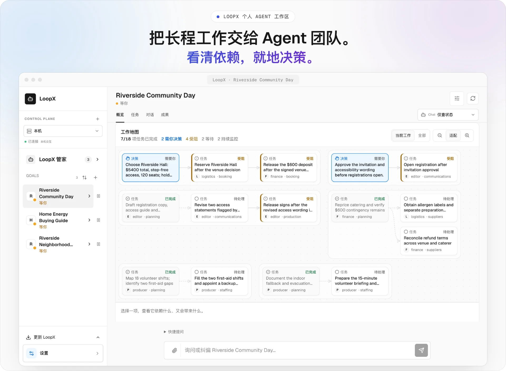
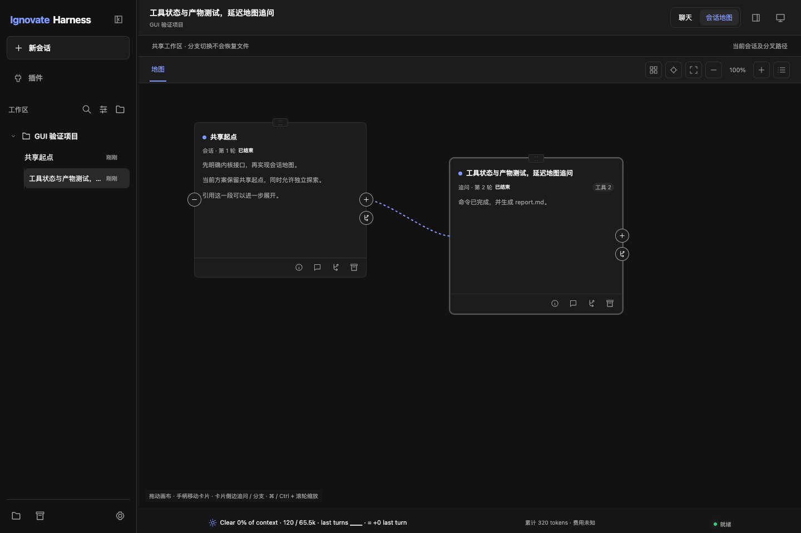
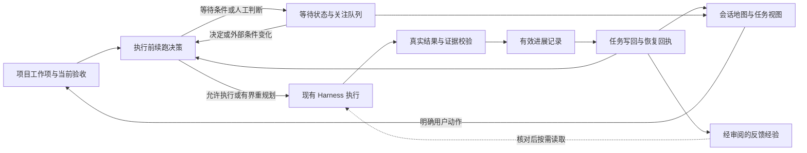

# LoopX 借鉴与 Ignovate Harness 统一优化报告：内核、任务与会话地图

评审日期：2026-10-14；实施记录：2026-10-15。对照版本：Ignovate Harness v1.1.0。初版分析基于 `8684767`，整合时 HEAD 为 `2df82cf`。第 1–9 节保留设计依据，第 10 节记录用户授权后的实际实施、验证结果与使用方法。

## 1. 结论与用户目标

用户希望把 LoopX 可借鉴的六项机制与会话地图改进整合为一套方案。目标是让 Ignovate 的内核能判断工作是否有效、是否应该继续，持久保存任务和交接，再由地图呈现同一份真实状态。会话地图是这套方案的操作入口和观察窗口。

### 六项机制与统一目标

| 优先级 | 值得借鉴的机制 | 对当前 Ignovate 的具体价值 |
| --- | --- | --- |
| **P0** | 判断是否产生有效进展 | 避免一直调用工具、修改文件，却没有接近验收目标 |
| **P0** | 每轮执行前决定继续、等待或重规划 | 等待 CI、外部结果或用户决定时，减少无效模型调用 |
| **P1** | 项目级任务身份与交接 | 让多个会话、分支围绕同一任务接续工作 |
| **P1** | 展示需要人处理的事项 | 用户打开工作台就知道哪个目标需要判断、为什么停下 |
| **P1** | 验证后写回及恢复回执 | 中断后识别哪些操作已完成、哪些记录尚未结算 |
| **P2** | 从反馈沉淀可复用经验 | 让用户纠正和审查结果影响后续任务，并保留适用范围 |

用户应能在同一个入口回答：**当前目标是什么、哪些要求已被证据支持、下一步为何执行或等待、哪一步需要我判断，以及中断后从哪里恢复。** 这六项机制分别落实到状态、执行规则、数据关联、界面投影与验收，不作为 UI 的附属功能。

LoopX 截图中可直接借鉴的形态是紧凑卡片、状态汇总、当前/全部视图、连线方向和选中项的上下文。Ignovate 已有真实回合、分叉、实时运行卡片、画布内追问、引用追问和布局保存，适合在这些能力上改进。

两个地图的关系不同：LoopX 截图呈现任务依赖、角色及人工决策；Ignovate 当前呈现真实对话的父子关系。会话连线只能表达上下文接续或分支，不能直接解释成任务依赖。后续任务地图需要由明确的任务、验收和决策数据支持。

统一方案建议先补齐有效进展和续跑判断，再建立跨会话任务关联与恢复记录，将这些事实接入会话地图和关注队列，最后引入经过审阅的反馈经验。已有预算、权限、输入指纹、证据覆盖与精确分叉保护继续作为约束。

界面延续 Ignovate 的蓝色强调色、黑白灰表面和明暗主题。方案覆盖内核变化、数据合同和界面建议；实际落地内容以第 10 节为准。

## 2. 参考与当前基线

### LoopX 参考截图



截图值得借鉴的地方：

- 地图标题与统计同处一行，先告诉用户整体状态。
- 卡片将类型、状态、标题和角色分层呈现，内容简短，便于并排比较。
- 决策卡片与普通卡片有明确的视觉区别，受阻卡片带文字说明。
- 连线有方向，背景分组帮助读者看到几组工作之间的关系。
- “当前工作 / 全部”降低信息密度，适配与缩放放在同一个操作区。
- 选中一项后，可以继续了解其前置条件与影响范围。

截图中的分组及角色标签不能证明产品会自动从聊天推导这些关系。LoopX README 也将工作区演示标为预设场景回放，不能据此认定截图本身是真实任务执行的证据。

### Ignovate 当前界面基线



上图来自仓库已有的 2026-10-13 验证截图，并非本轮重新运行或截图。界面判断同时核对当前源码，历史测试通过记录只用于说明已有保护，不作为本轮验收结果。

关键实现与事实：

| 位置 | 当前行为 |
| --- | --- |
| [map.js](../../nailong/gui/static/map.js) | `layoutNodes` 按父子深度与行号布局；保留手动坐标。`createMap` 渲染已保存节点与未提交的原生运行卡片。 |
| [style.css](../../nailong/gui/static/style.css) | 后置地图样式采用 310×280 固定卡片、单行标题和可滚动正文。`.active-path` 的蓝色边框被后置样式改成普通边框。 |
| [app.js](../../nailong/gui/static/app.js) | 地图仅取当前 `conversation_id` 及其分支；串行保存布局，保留新修订，拖动期间维护现有地图实例。 |
| [controller.py](../../nailong/gui/controller.py) | snapshot 提供 `nodes`、`branches`、`runs`、`approvals`；节点具有交付与产物信息，但公开的 `task_snapshot` 当前为 `None`。 |
| [branches.py](../../nailong/core/branches.py) | `gui-layout.sqlite` 持久化位置、折叠、视口及修订；布局写入检查版本与范围。 |
| [ui.js](../../nailong/gui/static/ui.js) | `completed` 显示为“已结束”；这表达回合结束，不证明任务验收通过。 |

内核当前并非空白，以下基础需要复用：

| 机制 | 当前实现 | 尚需补齐的部分 |
| --- | --- | --- |
| [目标状态](../../nailong/core/goal.py) | 已有稳定 Goal ID、持久状态、所属会话、轮数/成本保护、验证绑定及 `settled_round_ids` 去重 | 有效进展关联、执行前状态决策、跨会话目标与工作项的清晰边界 |
| [任务与验收](../../nailong/core/task_state.py) | 已有 `task_id`、需求修订、范围、约束、步骤依赖、验收和证据；任务记录按会话保存 | 同一个项目工作项关联多个会话，以及跨路径证据采用和交接规则 |
| [重复读取保护](../../nailong/core/progress.py) | 检查成功读取的参数、结果和版本重复，识别有限读取周期 | 识别动作变化但验收和证据没有增量的工作 |
| [目标执行](../../ui/flows.py) | 驱动连续回合，配置验证后评估交付，结算费用并处理暂停 | 在启动模型前决定执行、等待、针对性重规划或恢复结算 |
| [交付评估](../../nailong/core/delivery.py) | 需求版本、覆盖与当前输入指纹共同决定证据是否支持交付 | 跨会话证据来源和采用回执，明确最终改动审查的适用范围 |
| [记忆有效性](../../nailong/core/memory_knowledge.py) | 区分偏好、项目事实和经验，声明候选/确认、作用域、来源及有效性 | 反馈到经验的有界生命周期，以及后续应用结果和撤销关系 |

已有能力应继续保护：发送后的卡片立即可见；运行中拖动不会被刷新打断；连线随拖动更新；重载不重发请求；草稿保留正文和权限；共享祖先保持一个身份；只在可恢复边界继续或分叉。

## 3. 六项机制的内核与地图整合设计

### 3.1 P0：判断是否产生有效进展

**现状与问题。** `GoalStore.record_round()` 只在没有文件变化且没有工具调用时累计空转；`TaskStore.observe_progress()` 另行检查重复读取。这能发现部分重复行为，但工具不同、文件持续变化仍可能与目标无关。现有工具数应继续用于操作统计。

**建议的内核变化。** 在有界工作回合结束时，对照当前任务修订与验收，形成紧凑的进展记录。至少保留工作项、回合、相关验收条件、前后证据引用和来源。分类可以表达验收推进、新的有效证据、假设被排除、必要前置条件就绪、新阻塞、无变化和未知；这些是建议的数据分类，不是已实现 API。

新增证据必须核对来源、覆盖、需求版本和输入指纹，不能因为模型声称“新增了 evidence ID”就认定有效。失败实验在排除具体假设时可形成有效负结果；重复相同失败、纯改名或重新运行未变化的检查不能重复累计。模型可以提出解释，内核依据真实证据记录接受、拒绝或未知。

开始时先采用确定性指标与只记录模式，保留当前停止保护。观察稳定后再用有界无进展窗口触发重规划；阈值应可配置并经实际任务验证。可选模型评估器默认关闭，输出只作建议，不能决定完成、授权或回滚。研究和调查不能因没有文件修改而被误判停滞。

**地图呈现。** 回合卡片分开展示“已结束”和“验收进展”；选中详情列出它服务哪项要求、新增了什么依据及被排除的假设。证据过期后撤回当前有效标记，保留历史记录。“未评估”不能自动显示为“无进展”。

**验收。** 不同工具反复获取同样信息不能持续累计进展；有来源的负结果可计入探索；分页补读、新要求和新版本被正确区分；未知、过期或模型自述不能提高验收状态。新增机制的 token、延迟及误报应单独记录。

### 3.2 P0：每轮执行前决定继续、等待或重规划

**现状与问题。** 当前目标驱动在 active 状态连续推进，过程中受预算、审批、验收和停止规则约束。等待外部证据与缺乏有效增量需要更明确的执行前判断。

**建议的内核变化。** 在模型调用前构造一次可审计的续跑决策，读取当前任务、目标、证据、人工事项和剩余额度。建议结果包括执行、等待外部条件、等待人工判断、针对性重规划、恢复未结算记录和停止。结果应附原因、选定工作项、状态修订、允许的动作范围、恢复条件与适用时限。

决策是运行阶段投影，与持久目标的 active/paused/blocked/complete 生命周期分开；不要把所有等待塞进 `blocked`。目标阻塞的三轮保护仍保留，同时避免为了达到判定次数而重复启动模型调查一个已明确的外部等待。

检查顺序是权限与用户停止 → 输入/状态健康及在途恢复 → 人工或外部前置条件 → 有效进展与重规划义务 → 剩余预算 → 选定可执行工作。执行前再次核对修订；缓存决定不能跨条件变化沿用。等待 CI 时，有界只读检查可以由已有工具或可选适配器执行；没有变化就继续等待，新结果才触发模型分析。不能为此默认部署常驻服务或隐式创建定时任务。

重规划需有当前问题、原路径和新证据，可选择有依据地保持原方案；不要求为了产生变化而换计划。已经有效且输入未变的验证可复用，需要的新验证应针对证据缺口。界面或适配器不能绕过权限、预算与用户暂停。

**地图呈现。** 顶部显示“等待 CI / 待你判断 / 需要重新评估 / 恢复中”等具体原因；卡片给出下一步与恢复条件。无有效时间信息时不展示假的倒计时。没有新事实时保持安静，重大状态变化再提示。

**验收。** CI 状态未变不启动新的分析回合；新结果只触发一次合格工作；用户暂停优先于调度；额度不足零新增模型调用；过期决策被拒绝；针对性重规划不能解除未获批准的操作。

### 3.3 P1：项目级任务身份与交接

**现状与问题。** 当前已有 Goal ID 和 Task ID，但任务存储及验证绑定围绕会话。一个任务在多个分支探索时，缺少明确的项目级关联与采用规则。

**建议的数据变化。** 采用项目范围内稳定的工作项身份，关联一个或多个会话、分支、执行回合、验收与产物。保留当前 TaskStore 的需求和证据职责，通过明确迁移将会话任务记录变成来源或关联视图；同一工作项的要求与验收始终只有一个权威记录。迁移过程应版本化、可回退，并保留旧会话恢复能力。

共享祖先仍引用同一个对话节点。分叉不自动继承新权限、目标预算或执行归属；原有精确 checkpoint 保护继续生效。两个方案分支的证据各自保留执行来源与输入版本；把某个结果采用到共同工作项时，重新核对需求修订、覆盖及当前输入，不能把另一分支的旧通过状态直接复制过来。

交接包至少包含目标、约束、完成与未完成项、有效证据、已发生的效果、未知状态、下一步和授权边界。单主代理阶段可以先实现串行显式交接。开放多个写入代理时，再采用工作项认领、租约、隔离工作区与过期写回保护；当前项目执行锁不能仅为显示团队图标就删除。

**地图呈现。** 同一个工作项可关联多条会话路径，并显示各路径贡献。提供“会话路径”和“任务关系”两种视图：前者显示对话父子关系，后者只显示已登记的任务依赖；类型和图例明确分开。任务卡片可跳转到来源回合，回合可反查所属任务。

**验收。** 新会话接力不丢要求与证据来源；不同项目同名任务互不串联；分叉不复制预算或授权；需求更新后各路径的旧证据正确过期；交接重试不重复创建工作项或重放操作。

### 3.4 P1：展示需要人处理的事项

**现状与问题。** 原生审批、目标暂停、交付缺口和工具失败已有来源，但地图顶部缺少统一关注入口。`snapshot` 的 `task_snapshot` 当前为空，需要有界任务投影支持。

**建议的数据与执行变化。** 从现有目标、任务、审批和运行事件生成关注队列。条目至少包含稳定身份、类型、具体问题、作用范围、来源、相关工作项/回合、可选动作和解决条件。先覆盖工具审批、人工验收、需求歧义、交接采用和真实故障；不要让每条工具错误都变成人工问题。

人工决定与内部修复分开。系统能在既有授权内修复的情况先尝试修复，真正缺少用户判断时才提出问题。批准/拒绝必须回到原生审批或相应任务命令；显示卡片不能成为新授权。相关输入或作用范围变化时，旧决定不能自动沿用。任务关系中受该决定阻塞的工作与独立可执行工作要分别表达。

**地图呈现。** 汇总条可显示“2 项待你处理”，点击定位具体节点；详情给出问题、选项、影响和依据。工具审批使用原有参数及执行预览。任务层决定通过独立且有范围的结果记录处理，不能被普通“批准工具”按钮替代。顶部统计分别说明待批准操作数、待决事项数及等待项数，避免混用分母。

**验收。** 不显示模糊的“等待 owner”；条目能跳转真实来源；刷新不重复催促同一事项；已失效或已解决问题正确退出队列；批准前修订/输入变化会要求重新核对；隐藏路径仍有关注入口。

### 3.5 P1：验证后写回及恢复回执

**现状与问题。** 当前已有请求幂等、证据 ID 去重、`round_id` 去重结算和中断后不自动重放工具。这些保护需要进一步关联，才能解释一个回合中哪些阶段已经持久完成。

**建议的数据与执行变化。** 以统一运行 ID 和动作身份关联准入、执行观察、证据校验、任务写回、费用结算和关闭回执。各阶段保留版本化且有界的记录，恢复时重读已经提交的事实，补齐缺失阶段。多种文件、SQLite 与外部效果不能宣称一次全局原子提交；需要可重入的阶段流程、修订检查和幂等记录保证恢复正确。

已验证的证据先核对当前需求/输入，再更新相应验收；历史失败、拒绝和未知结果也须保存，不能因没有通过就丢掉执行事实。费用依据真实模型调用记账，不以验证成功为收费条件。有效工作额度、任务进展和提供商实际费用分别统计；同一次调用只结算一次，usage 缺失保持未知并沿用保守预算保护。

恢复不能因缺少回执就重跑 shell、重复发消息或重新执行外部写入。存在原生结果时读回核对；无法确认的副作用标为未知并限制后续自动动作。任务完成沿用已有验收、覆盖与输入指纹规则。最终改动审查需要绑定精确的最终范围，审查后再次修改就使其当前适用性失效。

**地图呈现。** 卡片或详情展示已执行、证据待核对、状态待写回、费用待结算及已关闭。显示历史产物及其来源，不通过当前文件内容伪造历史结果。旧运行的未知状态保持可见，不把恢复本身显示成新的任务进展。

**验收。** 在每个持久边界注入中断后，恢复都不重复执行副作用、不重复计费；任务修订变化拒绝旧写回；有副作用但无确认结果时显示未知；最终 diff 变化后旧审查不能支持当前交付。

### 3.6 P2：从反馈沉淀可复用经验

**现状与问题。** 当前记忆已有偏好、事实、经验、作用域与来源有效性。缺少反馈、经验采用和真实后续结果之间的明确关联。

**建议的数据与执行变化。** 将用户纠正、审查意见及已验证结果整理为经验候选，记录来源、适用情境、实际结果、建议的未来行为和失效边界。沿用现有记忆存储、按需读取和预算，不为此默认增加向量数据库或自动后台学习。

候选经过明确审阅或已授权的有界策略才晋升；反馈推导出经验内容不能扩张反馈者的动作权限。支持修订、替代、撤销和过期。经验在下一任务被采用时记录当前来源核对与理由；应用成功不自动证明经验造成成功，可以保持效用未知。当前用户要求与真实代码始终高于旧经验。

**地图呈现。** 在回合或任务详情中展示采用了哪条经验、适用范围、来源及版本，允许查看和纠正。可显示“来自此次纠正的经验候选”，不能把普通历史摘要自动标成已确认知识。

**验收。** 另一项目的经验不越界召回；过期/撤销记录不继续适用；用户新要求覆盖旧偏好；重复反馈不产生重复记录；模型自述不晋升为已验证结果；经验召回不改变审批规则。

### 3.7 六项机制的统一闭环



执行继续复用 `AgentService`、工具执行门与现有预算；任务、目标和证据由各自明确的内核职责维护。地图、关注队列、CLI/JSON 是同一份内核状态的投影。界面不另存完成率、授权或可执行状态，不建立第二套模型循环。

旧记录缺少新字段时，投影为未评估、未知或只读历史；不从聊天措辞猜测任务身份、完成状态和依赖。迁移与显示应分别验证。

## 4. 会话地图可优化点与优先级

下表是界面范围内的排序；总体实施优先级以第 1 节六项机制与第 6 节依赖顺序为准。

| 优先级 | 当前问题或限制 | 建议 | 预期收益与边界 |
| --- | --- | --- | --- |
| P0 | 310×280 固定卡片对短回答显得空，复杂地图需要频繁缩放 | 增加紧凑概览，并保留可阅读、可选择正文的展开模式 | 增加同屏信息量；摘要只能来自已保存正文，不能替用户生成未经核对的结论 |
| P0 | 当前路径样式与普通节点基本一致，选中项也主要靠中性轮廓 | 恢复路径强调，区分当前路径、选中节点和其它分支 | 选中节点不等于切换执行分支，必须分别表达 |
| P0 | 顶部只有“地图”和图标操作，没有整体状态 | 增加回合、分支、运行中、等待批准、异常/中断统计 | 全部来自原生数据，缺失数据保持未知；不显示虚构任务完成率 |
| P0 | “已结束”容易在视觉上被理解成工作已交付 | 回合状态与交付状态分开呈现 | `verified/reviewed/unverified/stale` 按已有证据显示，不把回合结束标成任务完成 |
| P1 | 地图展示全部分支时缺少当前路径范围切换 | 增加“当前路径 / 全部分支” | 共享祖先保留，过滤只改变视图；草稿、审批和运行不能被静默丢弃 |
| P1 | 实线/虚线缺少明确图例，连线没有方向箭头 | 给接续、分支及未提交运行添加方向与图例 | 这些关系表示对话上下文，不宣称任务依赖 |
| P1 | 长标题仅一行，正文和多个动作竞争注意力 | 标题最多两行，正文节选，动作分主次 | 继续追问、创建分支保留明确入口；归档等低频动作可以收进更多菜单 |
| P1 | “定位当前”实际优先定位选中节点，含义容易混淆 | 明确“定位选中”与“定位当前分支末尾” | 运行中优先定位当前分支的实时卡片，不跳到另一分支 |
| P1 | 详情展示信息，但地图本身缺少来源和分支关系提示 | 在选中详情中显示分支、父回合、直接后续回合、产物和交付依据 | 点击来源定位真实节点；用户无需猜测卡片属于哪条路径 |
| P2 | 深度乘以固定水平间隔，长主线容易横向拉长；布局包含逐节点全表查找 | 将布局常量统一，后续引入树布局与可选分支分组，并建立性能基线 | 首轮保留手动坐标；只在用户主动整理时重排已有节点 |
| P2 | 折叠后看不到隐藏多少回合、是否包含等待批准项 | 折叠节点显示后续数量与隐藏关注项 | 统计必须去重；定位隐藏节点时显式展开其祖先 |
| P2 | 多个卡片正文同时渲染，缩小时文字已难阅读 | 后续按缩放等级切换内容密度，评估视口外渲染裁剪 | 先测量，再实施；不能因裁剪使键盘定位和草稿状态丢失 |

## 5. 会话地图的统一呈现方案

### 5.1 方案选择

**推荐分层接入同一个工作台。** 会话路径先改善紧凑卡片、范围切换、连线与定位；内核机制落地后，将进展、续跑原因、关注队列、工作项和回执投影接入这些卡片及详情。每项界面能力必须有对应的真实来源和验收。

任务关系视图在项目级工作项与依赖合同落地后启用，复用地图的画布和选择体验。它与会话路径使用显式的视图切换，各自保留布局；不能复用会话的 `parent_id` 充当任务依赖。

单纯调整颜色、圆角和阴影无法解决进展、续跑和任务交接问题，视觉细化应随对应机制和信息层级一起完成。

### 5.2 顶部组织与阅读顺序

```text
会话地图        12 个回合 · 3 条分支 · 1 运行中 · 1 等待批准

[全部分支] [当前路径]      [概览] [展开]     [整理] [定位] [适配] [-] 100% [+]

                    会话关系画布

接续：实线箭头    分支：虚线箭头    未提交运行：虚线卡片
```

示例数字仅说明设计，实际界面必须使用原生数据。默认仍显示全部分支，避免改变用户对已有地图的范围预期。所有计数以当前会话及其分支的去重节点为基准；过滤后另外说明“显示 X / 共 Y 个回合”。运行计数只包含尚未形成节点的运行，提交后不重复累计。

窄窗口下统计可以换行，次要操作合并进有文字的菜单；不把主要按钮挤成无法点击的图标。当前项目和无关会话仍然隔离。

### 5.3 卡片层级与两种密度

概览模式建议宽度约 288–310 px、高度约 180 px：

1. 顶部：分支名称、回合序号和运行状态。
2. 标题：用户原始问题的最多两行节选，完整问题可在详情查看。
3. 正文：已保存或流式正文的有界节选，不调用模型另写摘要。
4. 底部：存在时显示工具数量、产物与交付状态；继续、分支和更多动作。

展开模式保留当前可滚动正文、Markdown 渲染和引用追问。概览模式可以选取可见文字；需要引用更长内容时切到展开或聊天。模式切换不能修改 checkpoint、历史正文或任务状态，也不自动整理手动坐标。

卡片尺寸、列间距、行间距、连线锚点、草稿位置和适配范围必须由同一组几何参数决定。当前代码多处写死 `310/280/360/320`；只改 CSS 会导致端口、连线和适配位置错位。首轮需要一起调整这些几何计算。

### 5.4 选中、路径、状态与连线

- 选中卡片使用清晰的蓝色轮廓；当前路径使用较淡的边框或背景提示；普通分支保持中性表面。焦点环单独保留。
- 运行中、等待批准、失败、中断都有文字标签。状态颜色复用明暗主题的语义变量，不仅依靠红绿判断。
- 灰色实线箭头表示同一路径的接续；蓝色虚线箭头表示分支。草稿连接与已提交的分支连接有可辨别的说明。
- 箭头指向后续回合；拖动时箭头与端点持续跟随，缩放后不能遮住按钮。
- 点击普通卡片只选择并查看详情；继续和创建分支仍由显式动作触发。不能把选中误当成发送、授权或切换执行路径。

### 5.5 当前路径、定位和关注项

“当前路径”读取当前分支的 `node_ids`，并加入属于该分支的未提交运行；不通过标题猜测归属。切换范围不删除坐标、折叠状态、草稿或事件。

如果切换后选中节点、草稿或关注项位于其它分支，显示简短提示和“查看全部分支”的入口。定位目标先展开其祖先，再移动视口。筛选后没有节点时，应解释当前范围没有可显示回合，并提供返回全部的动作。

关注队列先投影已有“等待批准”及跳转入口，随后按第 3.4 节接入有范围的人工决定。审批继续经过已有流程；截图中的“就地决策”需要精确的问题、作用范围、执行预览和原生结果，不能用一个通用按钮代替。

### 5.6 风格与可用性

延续已有系统字体、蓝色强调色和黑白灰表面。卡片采用适度圆角、细边框和克制阴影。点阵背景可以低对比度恢复，用来帮助定位；不能比文字和连线更抢眼。

界面状态改变不抢焦点，流式更新不重新定位画布。提供图标的可访问名称、可见键盘焦点和非拖动的操作入口。保持已有方向键移动、列表导航和 reduced-motion 行为。桌面 Web 控件需有至少 24×24 CSS px 的有效点击目标，常用操作宜更大；现有视觉尺寸为 28×15 的拖动手柄需检查并扩大有效命中区。

## 6. 统一数据合同与实施顺序

### 6.1 需要连起来的数据

| 数据 | 建议保留的最小关联 | 所属职责与地图用途 |
| --- | --- | --- |
| 项目工作项 | 项目身份、工作项 ID、目标 ID、需求修订、范围、验收、关联会话/分支 | 内核保存目标要求与任务身份；地图显示任务和来源路径 |
| 工作回合 | run/round ID、工作项/修订、会话/分支、准入决定、调用与动作引用 | 原生执行记录；回合卡片显示真实状态及来源 |
| 进展记录 | 当前验收条件、前后证据、进展分类、可信来源、适用性及未知原因 | 由内核核对；卡片解释这轮是否推进验收 |
| 续跑决定 | 输入状态修订、选定工作、允许的动作、原因、恢复条件及有效期 | 内核作决定，runner 执行；地图说明为何执行或等待 |
| 人工事项 | 问题 ID/版本、类型、作用范围、来源、选项、决定引用和解决条件 | 现有审批或有范围的任务决定保存；关注队列呈现 |
| 阶段回执 | 原运行与动作身份、观察、校验、任务提交、成本结算和关闭记录 | 各持久阶段幂等衔接；详情呈现恢复位置 |
| 反馈经验 | 来源、作用域、适用情境、结果、未来行为、版本与失效/撤销关系 | 复用已有记忆职责；详情追溯经验采用 |

字段表表达建议合同，不意味着要新增七个独立存储。优先复用现有任务、目标、会话事件、预算和记忆模块；新增持久关系只解决当前无法表达的关联。工作项、回合、证据与人工决定分别拥有稳定身份，避免以文本标题关联。

任务完成率来自明确任务集合和当前有效验收；回合结束数、任务完成数、已验证条件数使用各自分母。证据过期应与回合状态并存，缺少数据保持未知。CLI、无头 JSON 和 GUI 应消费同一投影，避免 GUI 成为唯一能恢复工作状态的入口。

### 6.2 分阶段落地

| 阶段 | 范围 | 依赖 | 本阶段交付与出口 |
| --- | --- | --- | --- |
| A：现状基线 | 核对当前任务/回合/证据身份、实际 usage 和关键恢复边界，保存可重现 fixture | 当前实现 | 现状指标、兼容约束与测试基线；不改变现有授权或完成规则 |
| B：P0 进展与续跑 | 在当前任务 ID/修订上增加有界进展记录和执行前决策；先只记录，再验证重规划规则 | A；已有证据与预算 | CLI/JSON 可查看进展、执行/等待原因与条件；重复无增量工作和已知外部等待可被正确识别 |
| C：P1 身份与恢复 | 建立项目工作项与会话/分支关联、显式交接、阶段回执及迁移 | B 使用的数据合同；现有幂等保护 | 跨会话接续与故障注入恢复通过；一个任务一份权威验收；不重复执行或计费 |
| D：P1 关注与地图 | 关注队列、具体人工事项、进展/续跑/回执投影，接入紧凑卡片、路径导航与任务关系视图 | B、C；已有原生审批 | 在同一工作台定位工作、等待和人工决定；所有显示可追溯；浏览器状态不拥有额外权限 |
| E：P2 反馈经验 | 经验候选、审阅/采用、后续结果、修订与撤销 | 稳定任务、结果和来源身份 | 有界经验流程及作用域隔离通过；测量实际收益，默认关闭可选评估器 |

地图纯展示的密度、箭头和焦点改进可以提前进行，但它们不替代 B/C 的内核工作。任务完成率、有效进展、执行恢复和任务依赖必须等相应来源可用后再显示；已有审批投影可以先落地。

每阶段需要小范围规格、迁移策略和对应验证，不能把五阶段作为一次不可回退的整体替换。本报告不承诺工期、费用或 benchmark 提升；可测量的出口定义优先于功能数量。

## 7. 统一实现影响范围

这是建议影响范围，不是已经实施的变更清单。模块拆分应依照最终规格，不要求把所有逻辑塞入现有文件。

| 范围 | 主要现有入口 | 建议负责的变化 |
| --- | --- | --- |
| 进展与决策 | `core/progress.py`、`core/task_state.py`、`core/goal.py`、`ui/flows.py` | 验收/证据关联、执行前决策、有界重规划与等待，维持现有预算护栏 |
| 任务与交接 | `core/task_state.py`、`core/task_context.py`、`core/sessions.py`、`core/branches.py` | 项目工作项关联、迁移、交接上下文与分叉边界；必要的新关系放在清晰的内核入口 |
| 证据与恢复 | `agent_service.py`、`core/verification.py`、`core/delivery.py`、`core/usage.py`、`core/cumulative_budget.py` | 证据与阶段回执关联、实际 usage 结算、重入恢复及最终改动审查的适用性 |
| 人工事项与投影 | `core/tool_approval.py`、`core/task_state.py`、`gui/controller.py`、CLI/无头输出 | 原生审批/人工验收与续跑原因的统一有界投影 |
| 反馈经验 | `core/memory.py`、`core/memory_knowledge.py`、记忆命令 | 候选、来源、采用、修订与撤销；继续共享原有读取预算和作用域 |
| 会话地图 | `gui/static/map.js`、`app.js`、`style.css`、`ui.js` | 统一几何、密度、路径范围、真实统计、方向、定位与选择；消费内核投影 |

表中 `core/` 与 `gui/` 均位于 `nailong/` 下。产品继续复用现有 Harness 执行与工具权限入口；新能力不得形成竞争的 Agent 循环、权限账本或任务完成状态。

视图偏好应与布局坐标分别管理，不在项目间复用。实现时先核对现有 GUI 偏好和布局扩展合同，再选择沿用已有持久化入口；不能未经校验把显示设置加入后端写入合同。

2026-10-14 评审阶段仅修改报告。2026-10-15 实施继续保留工作区中原有的轨迹、地图拖动和 IDE 改动，具体记录见第 10 节。

## 8. 内核、跨会话与地图的联合验收

### 8.1 内核验收

| 机制 | 必须验证的情况 | 观察指标 |
| --- | --- | --- |
| 有效进展 | 不同工具的无增量操作、新有效证据、有依据的负结果、未知/过期证据、需求变更 | 有效证据增长、误报/漏报、额外 token 与延迟；工具数量单独统计 |
| 续跑决策 | CI 不变/变化、外部等待、用户暂停、预算不足、旧修订、针对性重规划 | 等待期模型调用数、重复检查数、条件变化后响应；停止/权限规则一致性 |
| 项目任务与交接 | 两会话/多分支接续、项目隔离、需求修订、跨路径证据采用与重复交接 | 要求保留、来源完整、无重复工作项、无越权继承 |
| 人工事项 | 审批、人工验收、旧问题失效、故障自修复、拒绝/确认及重复事件 | 问题具体性、错误催促、用户介入次数和真实决定记录 |
| 写回与恢复 | 各持久阶段中断、重复结果、费用已结算、外部效果未知、最终 diff 变化 | 无副作用重放、无重复计费、未知标注、过期写回拒绝 |
| 反馈经验 | 项目/作用域隔离、候选/确认、撤销、冲突、新要求覆盖、重复反馈 | 错误应用、人工纠正次数、召回成本；无独立归因时效用保持未知 |

优先复用 `test_progress_detection.py`、`test_progress_service.py`、`test_goal_store_regressions.py`、`test_task_projection.py`、`test_managed_delivery.py`、`test_cumulative_budget.py`、`test_verification_cancellation.py`、`test_memory_context.py` 和 `test_context_memory.py`，新增能复现边界问题的用例。外部 CI/事件可采用本地确定性适配器，不要求真实模型或生产服务。

### 8.2 地图与端到端验收

| 场景 | 应满足的结果 |
| --- | --- |
| 短回答、长标题、Markdown 长正文 | 概览没有大块无效空白；标题可读；展开可滚动、选择与引用正文 |
| 共享起点及多个分支 | 当前路径显示准确，共享祖先去重；普通选择不切换执行路径 |
| 运行中、排队、等待批准、失败、中断 | 卡片与顶部统计一致；运行提交后只计一次；不把“已结束”当验收通过 |
| 发送、重载、聊天/地图切换 | 草稿与请求身份保留；无重复发送；实时卡片转换为已保存节点时位置不跳 |
| 拖动、缩放、适配与模式切换 | 连线及端口始终对齐；运行事件不打断拖动；手动坐标不被过滤或密度切换改写 |
| 折叠及隐藏选中项 | 定位会展开真实祖先；隐藏草稿和关注项有可见入口；列表能定位节点 |
| 布局延迟响应与旧 snapshot | 仍串行提交修订；旧快照不能覆盖已确认的新布局 |
| 明暗主题、1024×720、键盘与减少动画 | 状态有文字；无页面级水平溢出；操作有可见焦点和足够命中区；不自动抢焦点 |
| 500 节点 / 30 分支 | 沿用现有规模 fixture 重新测量；加载后的分支切换 p95 不超过现有 300 ms 验收预算；报告实际机器及测量方法 |

地图验证先运行 `tests/gui-map.test.mjs` 的关系与草稿用例，再使用隔离原生 Harness/假模型 fixture 检查浏览器流程。重点复用 `gui-map-live.spec.cjs`、`gui-layout.spec.cjs`、`gui-layout-stale.spec.cjs`、`gui-chat-map-sync.spec.cjs` 和 `gui-scale.spec.cjs`。新增端到端场景验证“CI 等待 → 新证据 → 工作项接续 → 人工决定 → 验证/写回 → 重载恢复”的内核事实与地图显示一致。

### 8.3 效果评估

固定模型、推理档位、任务、上下文策略和费用/调用上限，比较原实现与新机制。分别记录目标验收通过率、有效/无效工作回合、等待期模型调用、实际 token 与成本、耗时、用户介入和误停。调查任务应检查证据与假设收敛，不能只用代码变更数评分。

采用多次运行及针对性消融，区分进展判断、续跑决策、身份恢复和界面变化的贡献。样本不足时报告观察结果及不确定性，不宣称因果提升。确定性恢复与授权合同必须通过后，再开展有界真实模型评估。

本节列出评审时的验收目标；实施后的测试和性能数据见第 10 节。

## 9. 采用原则与资料

本报告覆盖六项机制与地图的整合，实施顺序以第 6 节为准：先验证当前身份与预算基线，再补 P0 有效进展和续跑决策，随后建立 P1 工作项/恢复/关注机制并接入地图，最后引入 P2 反馈经验。视觉改进和内核能力共享一个信息来源，分别保留可核对的验收出口。

LoopX 的探索能力有不同成熟度。进展评估哨兵、Decision Context 和 Reward Memory 都有默认关闭或实验边界，不能把完整路线图当成 Ignovate 首轮必须实现的功能。

LoopX 的 LHTB 报告中平均 Reward 相对 Plain Codex 提升 17.3%，但严格通过数同为 7/46，且部分运行预算更长。它提供机制研究线索，不证明迁入 Ignovate 后会得到相同提升。后续比较需固定模型、预算和任务，记录完成率、无效调用与用户介入次数。

主要资料：

- [LoopX 中文 README](https://github.com/loopx-project/loopx/blob/main/README.zh-CN.md)：产品定位、演示边界、工作区及 benchmark 限制。
- [LoopX 架构](https://github.com/loopx-project/loopx/blob/70bc98198ce9e8c33e461cc41fe77243d713dcf0/docs/architecture.md)：持久目标、投影视图、关注队列与任务协调。
- [Quota 与续跑合同](https://github.com/loopx-project/loopx/blob/70bc98198ce9e8c33e461cc41fe77243d713dcf0/docs/quota-allocation.md)：等待、续跑、重规划与回执结算。
- [进展评估哨兵](https://github.com/loopx-project/loopx/blob/70bc98198ce9e8c33e461cc41fe77243d713dcf0/loopx/capabilities/progress_review/README.zh-CN.md)：忙碌但偏离验收目标的观察机制。
- [Change Quality](https://github.com/loopx-project/loopx/blob/70bc98198ce9e8c33e461cc41fe77243d713dcf0/loopx/capabilities/change_quality/README.md)：绑定精确最终改动的审查回执。
- [Reward Memory](https://github.com/loopx-project/loopx/blob/70bc98198ce9e8c33e461cc41fe77243d713dcf0/loopx/capabilities/reward_memory/README.zh-CN.md)：反馈、经验、当前上下文与动作权限的分离。
- [Ignovate GUI 说明](../GUI.md)、[项目说明](../PROJECT.md)、[实时地图验证记录](2026-10-13-map-live-diffs.md)、[聊天与地图同步记录](2026-10-13-chat-map-sync.md)。
- UI/UX 依据使用本地 `ui-ux-pro-max` 的 dragging movements、keyboard navigation、color-only 与 compact label 指引；本项目采用原生 JavaScript/CSS，Stack 搜索结果仅用于布局及焦点原则，不引入 Tailwind 依赖。

## 10. 实施结果与使用方法（2026-10-15）

六项机制已接入本次源码改动。地图读取原生任务、目标和运行记录，原有执行权限、项目锁、预算及验收规则继续生效。

### 10.1 六项机制的落地范围

| 优先级 | 机制 | 本次实现 | 用户可见入口与边界 |
| --- | --- | --- | --- |
| P0 | 有效进展 | `goal_control.py` 对任务前后快照进行比较，引用当前验收证据、真实失败结果和经过版本核对的原生文件读取；重复结果不因换 ID 算新进展。Goal 保存最近 12 条记录及无增量窗口。 | 地图回合显示进展状态；未知证据保留为未知。网页、调查等没有可核对版本的观察不会被强行判为有效或无效。 |
| P0 | 执行前续跑决策 | 原生持续目标在模型流开始前判断 execute / wait / replan / stop。明确等待、人工验收、暂停及预算先于新调用；同一输入和任务版本连续 3 轮无增量时要求重核计划。发布决策期间状态改变也会重新检查。 | 等待期不打开目标轮次或调用模型；解除等待后仍需显式恢复目标。CI 条件由用户登记和确认，本次没有常驻 CI 监听器。 |
| P1 | 项目任务与交接 | `work_items.py` 为稳定 task_id 建立会话关联；关联会话共享同一份要求、验收及修订。旧任务懒迁移，新建独立任务保留原关联任务。跨进程锁和版本检查约束写回。 | 地图「项目任务」可关联到当前会话；CLI 可 list / link。关联不转移目标预算或工具批准。 |
| P1 | 关注事项 | 投影真实待审批、明确等待、待人工验收、过期人工确认及失败/中断运行。依据当前输入核对人工决定，有效豁免不会重复要求确认。 | 地图「关注事项」定位来源、解除等待、填写人工检查结果；工具审批打开原审批入口。确认不会替代测试、扩大工具权限或自动宣告整个目标完成。 |
| P1 | 写回与恢复回执 | GUI 运行记录 started / effects_observed / evidence_validated / task_committed / cost_settled / closed 的已知阶段。原生事件绑定 run_id；重启只从准确来源回合补齐缺失阶段，保留已写阶段，不重放工具或费用。 | 地图「阶段回执」可打开来源；缺失结果、估算用量和未知价格保持未知。旧日志缺少运行身份时按有限历史回合恢复，并保留副作用未知。CLI 持续目标沿用 GoalStore 的原生轮次结算，`/task control` 可查询项目 GUI 回执。 |
| P2 | 反馈经验 | `FeedbackStore` 保存情境、结果、建议及失效边界的候选；用户确认后通过现有 MemoryStore 写入、完整读回并记录版本。来源任务/修订/回合及已知输入指纹保留；撤销会从后续及历史记忆读取中移除正文。 | 地图「反馈经验」整理、确认、撤销；CLI 可查看和确认/撤销。候选不进入记忆，经验不能替代事实验证或授权；尚未进行自动效用评分、因果归因或 Reward Memory 检索优化。 |

### 10.2 地图与任务依赖

地图默认保留全部分支，新增当前路径、概览/展开阅读、去重统计、当前路径强调和方向箭头。概览卡片为 310×200，展开为 310×280；展开可滚动阅读完整保存正文并选取引用。过滤和密度切换保留手动坐标、草稿、发送身份与视口。被隐藏的选中回合、草稿及关注事项有提示，定位会展开真实祖先。

「项目任务」中新增来自 TaskStore.steps.dependencies 的步骤依赖图，只绘制已登记的前置关系。画布上的接续/分支箭头仍表示会话上下文，两类关系分别标注。跨会话的任务、经验和回执保留准确来源，不用当前可见分支的节点替换外部来源。


上图来自隔离项目的原生 GUI 与本地 Fake 模型，包含真实 TaskStore 关联、人工验收和反馈操作；它证明流程接入，不代表截图中的示例目标已通过实际业务验收。明暗主题与长正文样例见 [浅色地图](loopx-map-assets-2026-10-14/control-map-light.png)、[深色地图](loopx-map-assets-2026-10-14/control-map-dark.png)。后两张采用确定性的地图视图数据。

### 10.3 CLI 与 JSON

```text
/task list
/task control
/task link TASK_ID 要求修订
/task wait 要求修订 "等待原因" "恢复条件"
/task ready 要求修订
/task feedback list
/task feedback confirm FEEDBACK_ID 反馈修订
/task feedback revoke FEEDBACK_ID 反馈修订
```

命令返回 CommandResult.data，同一原生命令路径可提供 JSON 数据。要求修订和反馈修订分别校验；人工验收继续使用原有 `/task confirm ID 实际检查说明`。`/task control` 只呈现当前会话的目标预算。GUI 中的「记录反馈」会从选定任务的实际来源回合整理候选，关联会话共用同一任务状态。

### 10.4 验证与审查

- Python 全量离线测试：**1539 项，1495 通过、44 跳过**，耗时 149.91 秒；在临时源码目录中执行，不把用户本地偏好作为测试默认配置。末次回执来源投影调整后，12 项 GUI 控制回归及最终 74 项目标/任务/经验/回执回归通过。
- **9 组浏览器回归与 1 组 Electron smoke 通过**：新增原生控制流程、地图控制视图，以及旧的实时拖动、已发送请求拖动、布局串行/过期响应、聊天地图同步、500 节点规模、轨迹流程。控制流程验证关联、等待、人工决定、经验确认/撤销、准确来源导航与重载，确认这些操作不会新增模型调用。
- 纯地图测试 **11 项通过**；JavaScript/桌面语法与差异空白检查通过。
- 500 节点 / 30 分支，在 macOS arm64、1440×960、无头 Chrome 上，沿用现有 20 次切换样本：加载后分支切换 **p95 15.4 ms**，JS heap 约 **19.2 MiB**。这是本机确定性样本，不是所有设备或真实大项目的性能保证。
- wheel 构建及源码外安装 smoke 通过，17 个核心/命令/GUI 模块核对打包字节一致。测试使用隔离目录与本地假模型，未发送真实模型请求。
- 独立审查发现的 8 个重要问题及 2 个后续回归已按复现修复，覆盖暂停竞态、长反馈读回、写入/撤销中断恢复、过期人工事项、canonical task 锁、估算用量、准确恢复边界及来源身份。审查最终确认其复现范围内没有剩余 Critical / Important 问题。

可复查的原始命令日志和独立审查位于工作区 `.superpowers/loopx-control-map/`。测试范围及关键证据另见 [本次验收记录](2026-10-15-loopx-control-map-implementation.md)。

### 10.5 后续边界

本次完成本地内核与地图的一体化落地，代码保留在当前工作区，可在重新启动开发版 GUI 后使用。没有发布新的安装包；原有轨迹、拖动与 IDE 改动继续保留。

后续可在固定模型和预算的真实任务样本上评估误停、有效工作回合及成本，再决定是否加入外部事件适配器、调查类证据合同和经验检索/效用归因。本轮确定性验证不足以声称模型成功率或成本获得因果改善。
