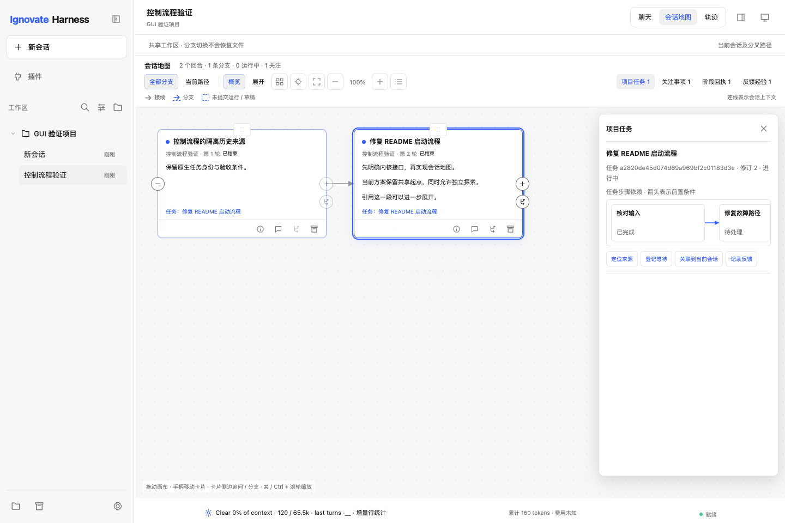

# Ignovate 六项机制与会话地图实施验收

日期：2026-10-15。依据：[统一报告](2026-10-14-loopx-map-optimization-report.md)、[实施计划](../superpowers/plans/2026-10-15-loopx-control-map.md)。用户授权为“开始实施”及“继续”。改动保留在现有工作区，未暂存、提交或发布；原有轨迹、地图拖动及 IDE 改动保留。

## 实现与验收对应

| 范围 | 主要实现 | 匹配的验收证据 |
| --- | --- | --- |
| 有效进展 | goal_control、GoalStore 有界记录、AgentService 版本核对读取、原生 drive_goal | 伪造/过期证据拒绝、重复失败不算新进展、新读取及新验证推进、取消仍结算 |
| 续跑准入 | execute / wait / replan / stop，发布后的稳定重查 | 等待与人工事项模型调用/轮次为 0；第二次发布期间暂停不会进入流；连续 3 次同版本无增量重核计划 |
| 项目任务身份 | work_items、TaskStore canonical authority 和显式 link/wait/ready | 旧数据迁移、跨会话共享修订、新建保留旧关联、跨进程串行、过期写回拒绝 |
| 关注与明确决定 | GUI work_control 和版本绑定动作 | 过期人工确认可见、有效豁免去重、等待条件明确、原生审批入口、忙碌状态拒绝变更 |
| 回执及恢复 | ControlLedger、native session run_scope、准确 node_history 边界 | 重入不重复记录、估算费用保持未知、恢复保留已写阶段、后续 CLI 事件不进入旧 GUI 运行、缺失历史任务不补造 |
| 经验反馈 | FeedbackStore、现有 MemoryStore、历史读取消除撤销正文 | 候选不入记忆；完整长正文读回；确认/撤销在记忆写入后中断可重试；来源任务/修订/已知输入核对；用户独立修改不覆盖 |
| 地图 | 共享几何、当前/全部路径、密度、方向、来源与 TaskStore 步骤依赖 | 手动位置/草稿/请求保留、实时拖动、正文选取、隐藏提示、准确跨会话来源、旧布局响应保护 |

## 验证

原始日志位于 `.superpowers/loopx-control-map/`；先失败再修复的回归记录也保留。

- 全量 Python：`native-full-release.log`，**1539 项，1495 通过、44 跳过，149.912 秒**。执行 `scripts/run_native_tests.py`；使用临时源码镜像，排除本地偏好、凭据与构建目录。末次回执来源元数据调整后的 `receipt-source-green.log` 为 **12 项通过**；`final-targeted.log` 为 **74 项通过**。
- 纯 JS：`node --test tests/gui-map.test.mjs tests/gui-control-map.test.mjs`，**11 项通过**。
- 浏览器：**9 组通过**。新增 `gui-work-control` 验证原生 TaskStore → 关联 → 等待 → 人工验收 → 候选/确认/撤销 → 重载 → 来源导航；`gui-control-map` 验证视图、完整 Markdown、引用、步骤依赖及显式动作。旧回归包含 map-live、map-request-drag、layout、layout-stale、chat-map-sync、scale、trace。各组使用新建隔离 fixture 和本地 Fake 模型。
- Electron：`gui-electron.spec.cjs` 通过，验证本地窗口、sandbox/context isolation 和窄原生桥接。
- 规模：macOS Darwin 27 arm64、1440×960、无头 Chrome，500 节点/30 分支；现有 20 次加载后切换样本 **p95 15.4 ms**，JS heap 20,105,266 bytes（约 19.2 MiB）。不能据此推断所有设备或真实项目表现。
- 构建：本地 wheel 成功，17 个核心/命令/GUI 文件与当前源码字节一致；源码目录外的 help、JSON doctor 和依赖 smoke 通过。未调用真实模型或修改真实提供商设置。
- 检查：相关 JS 与 desktop/main.cjs 语法检查、`git diff --check` 通过。

## 独立审查

审查与后续关闭记录位于 `.superpowers/loopx-control-map/independent-review.md`。最初 8 个重要问题和 2 个后续回归均按准确复现处理：暂停竞态、长经验读回、撤销中断、过期人工事项、GUI canonical 锁、估算用量、会话尾部误归属、反馈来源修订/输入、node 引用格式和跨会话来源配对。最终审查确认其范围内没有剩余 Critical / Important 问题；审查没有代替实现者运行全量测试。

## 使用与边界

重新启动开发版 GUI 后，会话地图显示项目任务、关注事项、阶段回执和反馈经验。CLI 的 `/task list|control|link|wait|ready|feedback` 使用同一份项目状态。关联共享任务事实，预算、权限与批准继续由原有 owner 管理。

本次等待依赖用户登记/确认与显式恢复，没有常驻 CI 监听或自动唤醒。读取缺少版本和覆盖时保留未知；经验效用归因尚未实施，候选/用户声明不提升为事实或授权。GUI 回执新增运行阶段核对；CLI 持续目标继续使用原生 GoalStore 轮次结算，并可查询项目 GUI 回执。旧日志的运行归属无法确认时不补造完整费用或副作用结论。

没有发布新安装包，也未开展固定预算的真实模型效果评估；本轮不能声称成本或任务成功率获得因果提升。

